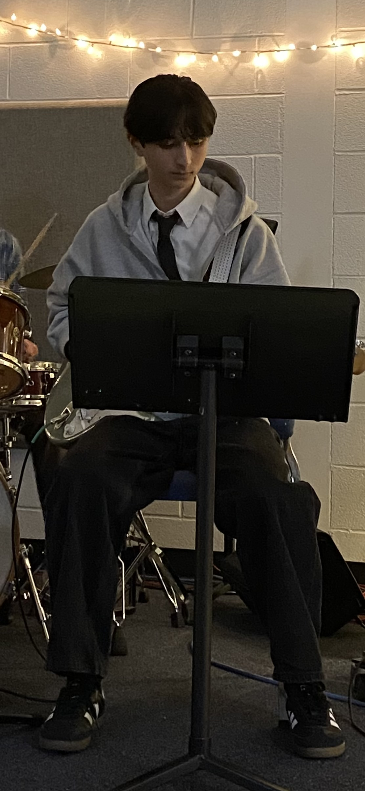

# Profile #

## About Me ##
My name is **Connor West** and one thing about me is that I *really* enjoy listening and performing any kind of music

## Technical Background ##
I have a diverse technical background in creating digital media, however my coding background is limited to only Scratch
### Technical Skills ###
Some examples of my technical skills are:
- Photoshop/Photo Editing
- Video Editing
- Game Creation
#### Favorite Coding Language ####
`I don't have much experience with any of them but at the moment I suppose JavaScript could be my favorite`
## Goals ##
My goals for Web Design this semester are:
1. ~~Joining the Web Page Design class~~ 
2. Obtaining a better idea of coding
3. Have the ability to confidently create web pages
4. Use my abilities in web page design to design my own web page to promote myself online
## External Links ##
` My Github Profile:`
[Github](https://github.com/Westc20714)
`My NewPaltz Email:`
[Email](westc2@newpaltz.edu)

## Extra ##

### A Picture That I Like ###

- **This is a cat playing MineSweeper, which is a game I like to play.**
### One of My Favorite Quotes ###
> “We are all dreaming of some magical rose garden over the horizon instead of enjoying the roses blooming outside our windows today” - Dale Carnegie
### Snippet of Code ###
```
let a = [9, 3, 5, 1];
a.sort((x, y) => x - y); // Ascending
console.log(a);

a.sort((x, y) => y - x); // Descending
console.log(a);
```
### Features I Plan To Build ###
- [x] Add an image to a webpage
- [] Add a video to a webpage
- [] Implement a game into a webpage

